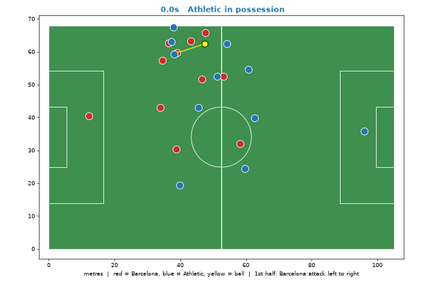

# Analysis environment

Python 3.12 and every library are declared in `../pyproject.toml`, pinned to the tested versions.
There is no lockfile, so `uv` resolves the pinned libraries' own dependencies fresh.

## Set up (macOS or Linux/WSL2, x86_64 or Apple silicon)

```bash
curl -LsSf https://astral.sh/uv/install.sh | sh     # once
git clone -b dev https://github.com/iamkarthikarun/more-than-a-hack-2027.git
cd more-than-a-hack-2027
uv sync                                              # fetches Python 3.12 and all libraries
```

## Branches

- `main` stays a clean copy of the fork's starting point.
- `dev` is the working branch for all experiments. Day-to-day: `git pull` on `dev`, commit,
  `git push`. For something risky, branch from it (`git switch -c exp/<name> dev`) and merge back
  into `dev` when it works.

On Linux the CUDA build of torch is installed, which is several GB. For a GPU you only need
the Windows NVIDIA driver; no CUDA toolkit inside WSL2. Check it:

```bash
uv run python -c "import torch; print(torch.cuda.is_available())"
```

## Data

The match data is gated and is not in git. Put `tactical/` (and optionally `broadcast/`) under
`data/`, or point `MTAH_DATA_DIR` at the folder holding them. On WSL2, keep it on the Linux
filesystem (`~/...`), not under `/mnt/c`, which is much slower.

## Run

```bash
uv run python analysis/overview_plot.py    # coverage overview -> analysis/figures/overview.png
uv run python analysis/make_gif.py         # 24 s animated clip -> analysis/figures/clip.gif
```



`analysis/tracking.py` parses the tracking file once and caches it in `data/_cache/`.
Everything in `data/` and `analysis/figures/` is git-ignored on purpose, except the example
`clip.gif` above: RULES.md forbids publishing the data or anything that reconstructs it.

## Other-match data (open DFL/Sportec, CC BY 4.0)

`analysis/dfl.py` reads other matches from https://doi.org/10.6084/m9.figshare.28196177 (CC BY 4.0,
attribute the dataset paper in `analysis/fetch_dfl.py`), which carry per-frame possession and
ball-status labels the provided match lacks. `fetch_dfl.py` downloads them into
`data/external/dfl/` and checks every file against the publisher's MD5, so any machine ends up
with byte-identical copies. The positions file is 350-420 MB per match.

```bash
uv run python analysis/fetch_dfl.py                  # two matches (~740 MB); name others to add them
uv run python analysis/fetch_dfl.py --list           # all 7 matches and their sizes
uv run python analysis/fetch_dfl.py --verify-only    # check what is already on disk
uv run python analysis/dfl_baseline.py               # nearest-player baseline on every downloaded match
```

A fresh machine needs the download step above. Each match scores the same whichever subset is
downloaded, because its hidden-ball gap pattern is fixed per match.

Reference, spellF1 with the ball hidden at the +-50 frame window (from a clean-clone run on a second
machine, with J03WN1 and J03WOH also reproduced exactly on the first):
`J03WMX 0.232, J03WN1 0.207, J03WOH 0.220, J03WOY 0.174, J03WPY 0.225, J03WQQ 0.241, J03WR9 0.188`,
mean 0.212.

## Making DFL look like the provided match

DFL is clean (ball always tracked, all 22 players, raw 1 cm-quantised positions); the provided tactical
tracking is not. `analysis/degrade.py` learns the difference from the provided match's tracking alone
(no labels) and applies it to DFL; `analysis/degrade_eval.py` fits it, checks the result and scores the
baseline on it.

```bash
uv run python analysis/degrade_eval.py                                          # every downloaded match
uv run python analysis/degrade_eval.py --matches DFL-MAT-J03WOH DFL-MAT-J03WN1  # exact subset
```

What was measured on the provided match:
- **Ball:** hidden on 41% of in-play frames in ~150 gaps (median 10.7 s). It vanishes when it is
  *slow* (median 2.0 m/s against 5.2), close to a player, or near a touchline (25% of onsets within
  4 m of one, against 13%), not when it is fast. Only 149 onsets, so the covariate model is weak
  (cross-half AUC 0.64 and 0.74); a constant-hazard control is kept next to it.
- **Players:** a track ends mostly under occlusion (62% within 2 m of another player, against 12%),
  at low speed or near a touchline (cross-half AUC ~0.87). All 11 of a team are tracked on only
  ~55-60% of frames.
- **Positions** are far smoother than DFL's raw ones (velocity autocorrelation 0.999 against 0.879),
  so DFL is smoothed (Gaussian, 2 frames), not made noisier.
- **Not modelled:** 2-4 m single-step ball jumps (0.19% of ball frames) and extra phantom tracks that
  give a team a 12th or 13th player on ~5-8% of frames. The 3+ players-missing tail is under-produced
  (about half of the provided 8-10%).

Result, nearest-player baseline, spellF1 at the +-50 frame window, two matches (J03WOH, J03WN1):

| ball condition | spellF1 |
|---|---|
| always visible, clean players | 0.292 |
| hidden: provided gap pattern copied | 0.214 |
| hidden: constant hazard, real gap lengths | 0.201 |
| hidden: learned hazard, real gap lengths | 0.231 |
| learned ball hazard + players dropped + smoothed | 0.225 |

The masks agree within about 0.03, so the exact mask is not the main uncertainty. The learned hazard
hides the ball less often at real possession changes (32%) than overall (42%), because it favours slow
and dead-ball moments where "ball hidden means dead" happens to be right; the constant hazard is the
pessimistic bound. These are simulated; the organisers' published full-match floor is 0.2433.

## Hold the last owner

`analysis/hold_owner.py` replaces "nearest player, and call it dead when there is no ball". The owner
changes only on a frame where the ball is visible and a player is within `r_control` metres, and is
held through gaps and flight. Dead ball needs evidence at a visible frame (ball outside the pitch, or
hardly moving over 2 s), held through gaps. Runs shorter than `min_spell` / `min_dead` are merged away.
`analysis/hold_owner_eval.py` scores it on degraded DFL, choosing settings on the other matches only.

```bash
uv run python analysis/hold_owner_eval.py --matches DFL-MAT-J03WOH DFL-MAT-J03WN1   # ~9 min
```

spellF1 on the held-out match, mean of two matches (tuned on the other one):

| ball condition | nearest + vote | hold the last owner |
|---|---|---|
| clean ball | 0.292 | 0.552 |
| constant hazard (pessimistic) | 0.186 | 0.348 |
| learned hazard | 0.226 | 0.374 |

Against labels with every spell under 3 s merged (a proxy for "controlled possession"): 0.345 to 0.660,
0.207 to 0.392, 0.259 to 0.426. Chosen settings: `r_control` 0.75 to 1.0 m, dead state held without
limit, `d_still` 1 to 2 m. **`min_spell` follows the label definition** (10 frames on DFL's labels, 75 on
the merged ones), so it must not be tuned on DFL; it is the open question about the organisers' ground
truth.

What is still weak: with the ball hidden, dead/alive F1 is 0.75 to 0.83 (0.97 with a clean ball) and
team accuracy on live frames 0.73 to 0.83 (0.87 clean). Both gaps are what player-only inference during
ball gaps would have to close.

Limits: two matches, DFL's labels (finer than the organisers'), and a simulated mask. The held-out
gain is large and consistent across both matches, but it is not a score on the real match.

## Event log of the provided match

A third-party event log of this match (Kaggle, `2445027 Barcelona-Athletic Club.xlsx`, uploader and
licence unknown) is used with the organisers' permission (confirmed by email on 2026-10-24; they also
said submissions are evaluated on other, unreleased matches, so nothing may be tuned to this one). It is
not in git: put it at `data/external/kaggle/`, which `data/*` in `.gitignore` excludes.

- `analysis/events.py` reads it with the standard library only. `analysis/pseudo_gt.py` turns it into
  H/A/D frame labels with rules written beforehand from CHALLENGE.md: a stoppage event makes the ball
  dead, a restart event makes it alive for the restarting team, and only controlled actions move
  possession. It is a proxy, not the organisers' ground truth (which comes from corrected tracking).
- **Alignment:** event wall time maps to video time as a pure shift per half, set by the kick-off
  anchors in `games.py` (the two halves differ by 0.15 s). Event times are only good to about a second,
  and the real ball is too often hidden to refine them from kicks.
- **Check against the public 5 minutes** (labels meaning what we think, not tuning): 89% of frames
  agree, 93% on dead/alive, 94.7% on the team when both say alive; shifting the events by 2 s in either
  direction makes it worse. 14 possessions against the public 17.
- `analysis/real_eval.py` scores methods on the real tracking against it (202 possessions, full match).
  The shipped baseline gets spellF1 0.231 (published floor on the real ground truth: 0.2433), so the
  scale is right. Hold-the-last-owner gets 0.362 to 0.383 with settings chosen on DFL only.
  `min_spell` peaks near 75 frames (about 0.38) and is flat from 50 to 125; it drops to 0.27 at 10.

**Where the ball goes missing, on the real tracking** (hidden share of frames by event-derived label):
Barcelona in possession 7.0%, Athletic in possession 22.1%, dead ball 71.2%. About 80% of all hidden
frames are dead-ball frames. The simulated masks in `degrade.py` are far more uniform (about 36%, 35%
and 56%), so they are pessimistic about live play and too weak on the dead-ball link. Hidden-ball
duration, and where the ball was last seen, are therefore strong dead-ball evidence that the DFL
simulation does not yet reproduce.

## Finding a frame or an event in the tactical video

The tactical video is one continuous 25 fps recording, from its first frame to the last: pre-match, both
halves, drinks breaks, halftime and post-match are all in it, so everything is measured from frame 0.

| quantity | formula |
|---|---|
| video time of frame `i` | `i / 25` seconds (`ms = i * 40`), i.e. `HH:MM:SS.mmm` |
| submission row / ATD `frame_id` | `i` / `i + 1` |
| Smart Tagging second `s` | frame `round(s * 25)` |
| event, 1st half | video seconds = match clock + 446.444 |
| event, 2nd half | video seconds = match clock + 1849.601 (the clock restarts at 45:00) |
| frame of an event | `round(video seconds * 25)` |

The event log's match clock is an exact straight shift of wall time inside each half (zero spread over
every event, drinks breaks included), and the two halves' offsets differ by only 0.15 s across the 68
minutes of halftime, which confirms a single continuous clock. Event times are operator-logged and good
to about +-1 s. Landmarks: 1st-half kick-off 00:07:27.440 (frame 11186), 2nd-half kick-off 01:15:49.640
(frame 113741); both are the organisers' anchors, so seek to them to check your player has no start
offset. `analysis/video_time.py` does all of this:

```bash
uv run python analysis/video_time.py frame 18009            # timecode, half, match clock
uv run python analysis/video_time.py time 00:12:00.360      # timecode to frame
uv run python analysis/video_time.py events "Goal kick"     # every such event with its timecode
uv run python analysis/video_time.py around 18009 --seconds 8
uv run python analysis/video_time.py timeline               # kick-offs, whistles, graded blocks
```

Note that the graded 1st half runs 78 s past the 1st-half whistle in the event log (59:08 against 1:00:26).
